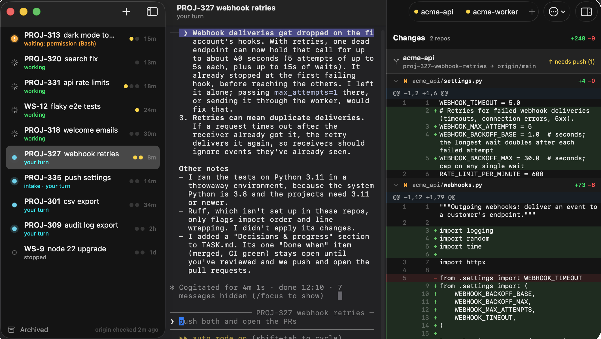

# wm: the task layer for Claude Code

**One ticket. Every repo it touches. One Claude Code conversation, kept on the rails.**

Other agent tools model a *session*: one agent, one repo, one branch. `wm` models a *task*: one ticket, N repos,
one conversation, N PRs and one definition of done.

- 🎙️ **Describe the task by voice or text.** Claude writes the brief and picks the repos it needs.
- 🌳 **An isolated git worktree per repo**, on a branch named after the ticket. Your main checkouts stay clean.
- 🛡️ **Strong guardrails.** No edits in your main checkouts, no branch switching, and **no agent writing over
  another's branch**.
- 🔄 **Live git status integration.** Git, PR and CI state for every repo, plus commits behind `main`, refreshed in
  the background.
- 🚦 **One dashboard for every task.** Who is waiting on you, and **what each repo needs next**, from "needs push"
  to "ready to merge".
- 🧹 **Archive that never loses work.** It refuses while anything is uncommitted or unpushed.
- 💻 **The real `claude` CLI on your subscription**, in a native Mac app or your terminal. Local: no API keys, no
  cloud.



## Install

**Workstreams.app** is `wm` as a native Mac app: your workstreams in the sidebar, the selected one's Claude session
in the middle, and what its branches change on the right. It carries `wm` and a Python of its own.

1. Install what it drives: git, tmux and Claude Code (logged in), plus `gh` for PR and CI status:

   ```sh
   brew install tmux gh && gh auth login
   ```

2. Download the disk image for your Mac from the
   [latest release](https://github.com/inreachventures/agents-manager/releases/latest): `apple-silicon` for M-series
   chips, `intel` for Intel. Open it and drag Workstreams to Applications. It needs macOS 14 or later.
3. Open it. The app isn't signed with an Apple Developer ID, so the first time macOS blocks it as from an
   unidentified developer. Close the warning, then click **Open Anyway** in System Settings → Privacy & Security (on
   macOS 14: Control-click the app and choose **Open**). Or, in Terminal:
   `xattr -dr com.apple.quarantine /Applications/Workstreams.app`.

A short tour points at each part of the window. `wm` looks for your repos in `~/code`; Settings → Repos changes that.

**Prefer the terminal?** The same dashboard runs as `wm`, and both work on the same sessions, so you can use either
or both. Settings → wm shows the command that puts the app's `wm` on your PATH; to install it from source, see
[wm in the terminal](docs/cli.md).

## Quick start

Click **+** (⌘N) and describe the task in the Claude session that opens, by voice or text:

> "This is PROJ-313. Add a dark mode toggle: acme-api needs to store the preference and the web UI needs the
> toggle. Done when both are merged."

Claude names the workstream (`PROJ-313 dark mode toggle`), writes `TASK.md`, attaches `acme-api` and `acme-web` as
worktrees on `proj-313-dark-mode-toggle`, summarises the plan and waits for your **"go"**. Then pick another
workstream and get on with other work: the sidebar shows which ones wait on you and ⌘J jumps to the next. When the
PRs are merged, archive it (⌘⌫).

## How wm compares

| | **wm** | Claude Code, built in | Agent Deck | Agent of Empires | Conductor | Claude Squad | Herdr |
|---|:-:|:-:|:-:|:-:|:-:|:-:|:-:|
| One ticket across several repos: a worktree per repo, one conversation | ✅ | ◐ ¹ | ✅ | ✅ | ❌ | ❌ | ❌ |
| The agent attaches repos itself mid-task, the manager creates worktree and branch | ✅ | ◐ ² | ❌ | ❌ | ❌ | ❌ | ◐ ¹¹ |
| A task brief written at intake that survives compaction and resume | ✅ | ◐ ³ | ❌ | ❌ | ❌ | ❌ | ❌ |
| Guardrails: no edits in your main checkouts, no branch switches, "do this instead" messages, drift detection | ✅ | ◐ ⁴ | ◐ ⁵ | ◐ ⁵ | ❌ | ❌ | ❌ |
| What each repo needs next, from git + PR + CI, plus commits behind base | ✅ | ◐ ⁶ | ❌ | ❌ | ✅ ⁷ | ❌ | ◐ ¹² |
| Rebase every repo of the task on request, conflicts handed back to the agent | ✅ | ❌ | ❌ | ❌ | ❌ | ❌ | ❌ |
| Archive that refuses to lose work, unarchive into the same conversation | ✅ | ◐ ⁸ | ◐ | ◐ | ◐ | ❌ | ◐ ¹³ |
| Adopt work in progress (branch and uncommitted changes) from a normal checkout | ✅ | ❌ | ◐ | ◐ ⁹ | ◐ ⁹ | ❌ | ◐ ⁹ |
| Sessions outlive the terminal, with "needs you" status | ✅ | ✅ | ✅ | ✅ | ◐ | ◐ | ✅ |
| Real `claude` CLI on your subscription, in your terminal | ✅ | ✅ | ✅ | ✅ | ◐ ¹⁰ | ✅ | ✅ |

<sub>✅ yes · ◐ partly · ❌ not in the project's docs. Checked against each project's public docs on 2 October 2026
(Herdr on 6 October). These tools move fast; if a cell is wrong, please open an issue.</sub>

<sub>¹ `--add-dir` shares other repos without isolating them; `--worktree` covers only the repo you launch from;
multi-repo threads exist in cloud Projects (beta).<br>
² `/add-dir` gives access to another folder, without a worktree or a branch.<br>
³ Cloud Projects only.<br>
⁴ Deny rules and hooks to build your own policy; `--worktree` sessions can't write to the main checkout.<br>
⁵ Container sandboxes.<br>
⁶ A PR badge for the current branch of one repo.<br>
⁷ One repo per workspace.<br>
⁸ One repo at a time: `claude rm` refuses unpushed commits.<br>
⁹ Starting from an existing branch; uncommitted changes aren't carried over.<br>
¹⁰ A macOS app built around Claude Code, not a terminal tool.<br>
¹¹ The agent can run `herdr worktree create`, but the worktree opens as a separate workspace, outside its
conversation.<br>
¹² Branch and ahead/behind counts in the sidebar; no PR or CI state.<br>
¹³ `herdr worktree remove` needs `--force` when Git refuses a dirty checkout; no unpushed-commit check and no
unarchive.</sub>

**wm doesn't replace Claude Code's agent view.** Agent view is a great way to watch plain sessions. `wm` adds the
layer Claude Code leaves to you: what a session is for, which repos it may touch, and when the task is done.

**Herdr runs agents; wm runs tasks.** [Herdr](https://herdr.dev/) is a terminal runtime for over 20 agent CLIs on
macOS, Linux and Windows, including machines over SSH, where `wm` is Claude Code and macOS only. It has no task,
brief or guardrails, and its own docs say it pairs with a worktree manager.

## How it works

A workstream is one task: a key (`PROJ-313`, or `WS-7` without a ticket), a 3-word name, and a folder holding one
git worktree per repo and exactly one Claude Code conversation at its root:

```text
~/workstreams/PROJ-313/          ← Claude's working directory
    CLAUDE.md                    ← generated by wm: identity, repos, branches, rules
    TASK.md                      ← the brief Claude writes at intake: goal, done-when, decisions
    .claude/settings.json        ← generated: status hooks, guard hooks, deny rules
    acme-api/                    ← git worktree on proj-313-dark-mode-toggle
    acme-web/                    ← git worktree on proj-313-dark-mode-toggle
```

**The agent asks, `wm` builds.** Claude never creates worktrees, switches branches or deletes anything. When it
needs another repo it runs `wm add-repo`, and `wm` creates the worktree and the branch.

- **Voice-first intake.** Claude names the task, writes `TASK.md` and attaches the repos, fuzzy-matching dictated
  names.
- **One memory for all tasks.** What Claude learns about how you work is saved once and loaded in every
  workstream; facts about a single task stay in its `TASK.md`.
- **Survives compaction.** `CLAUDE.md` and `TASK.md` reload after compaction and on resume, with live git and PR
  state.
- **Guardrails that redirect.** Edits outside the workstream, git writes in `~/code/<repo>`, `git switch`,
  `checkout`, `worktree` and `clone` are blocked **with a "do this instead" message**. Drift is caught after every
  command.
- **The next step for each repo.** `✎ uncommitted`, `↑ needs push`, `needs PR`, `✗ CI failing`,
  `● ready to merge`, `✓ merged`, plus "N behind base".
- **Rebase the whole task.** Every branch behind its base, force-pushed with a lease. **Conflicts go back to
  Claude.**
- **Archive that won't lose work.** **Refuses on uncommitted, unpushed or post-merge commits.** Restoring brings
  back the worktrees and the conversation.
- **Adopt work in progress.** Claude can move a branch and its uncommitted changes from a normal checkout into the
  workstream, and **rolls back if any step fails**.
- **Outlives your terminal.** Sessions run in `wm`'s own tmux server, with "needs you" status and macOS
  notifications.

## Usage

You only need two places: the dashboard and the Claude sessions it opens.

**From the app:** select a workstream to see its session. Every action is in the toolbar's `…` menu and when you
right-click a workstream:

| Shortcut | What it does |
|---|---|
| ⌘N | New workstream: a Claude session opens and you describe the task |
| ⇧⌘A | Attach another repo to the selected workstream |
| ⇧⌘↩ | Resume a stopped session, in the same conversation (after a reboot, say) |
| ⇧⌘B | Rebase every branch of the task that is behind its base; conflicts go to Claude |
| ⌘⌫ | Archive: safety check, then stop the session and remove the worktrees |
| ⌥⌘A | Show archived workstreams, to restore one with its worktrees and conversation |
| ⌘R | Refresh git, PR and CI state now |
| ⌘J | Next workstream waiting on you |

Quitting the app leaves the sessions running. [`macos/README.md`](macos/README.md) covers the rest of the window;
[wm in the terminal](docs/cli.md) has the dashboard's keys and the commands.

**From the chat:** ask Claude, and it runs `wm` for you.

- *"We also need acme-mobile."* Claude attaches the repo.
- *"Continue the work I have in web."* Claude moves your branch and uncommitted changes from `~/code/web` into the
  workstream, after showing you the plan.

Whichever way a repo joins, `wm` guarantees it **lives as a worktree inside the workstream folder**, on the task's
branch, **listed in the task's `CLAUDE.md` and covered by its guardrails**.

The app is only a view: sessions live in `wm`'s tmux server and every action goes through `wm`, so the guarantees
above hold whichever you use.

Optional config in `~/.agents-manager/config.toml` (Settings → Repos edits the first two):

```toml
code_roots = ["~/code"]                # folders holding your repos; their checkouts are protected
repos = ["~/elsewhere/side-project"]   # single repos kept elsewhere, protected the same way
workstreams_dir = "~/workstreams"      # where workstream folders are created
```

## Limits

- **macOS and Claude Code only.** Notifications use `osascript`; status and guardrails are built on Claude Code hooks.
- **The shell-command check is best-effort.** A command written to get around it can slip past; drift detection
  catches the result, not the attempt. There's no OS-level sandbox yet.
- **Repo-level Claude settings don't apply.** Each repo's `CLAUDE.md` is loaded, but its `.claude/settings.json` and
  `.mcp.json` are not, because Claude Code only reads those from the working directory.
- **The diff view is read-only and app-only.** Review and comment on the PR. PR and CI state needs `gh` and GitHub.

## Disclaimer

**Use at your own risk.** This software is provided as is, without warranty of any kind (see `LICENSE`). `wm` runs
git commands that create and remove worktrees, delete branches, stash changes, rebase and force-push (with lease),
and it starts Claude Code sessions that change your code. The safety checks reduce the risk of losing work, but they
are not a guarantee. The authors are not responsible for any data loss or other damage resulting from its use. Keep
your work committed and pushed, and keep backups.

## Develop

```sh
.venv/bin/pytest -q
.venv/bin/ruff check src tests
macos/scripts/build-app.sh --open      # build the native app for this Mac and open it
```

CI (`.github/workflows/ci.yml`) runs the tests and builds the app's disk images on every push and pull request to
`main`. To release, bump `version` in `pyproject.toml` and push a matching tag (`v0.2.0`): CI publishes the disk
images as a GitHub release. See [`macos/README.md`](macos/README.md) for how the app is built and works.

`DESIGN.md` explains the reasoning behind each design decision. MIT licensed, see `LICENSE`.
