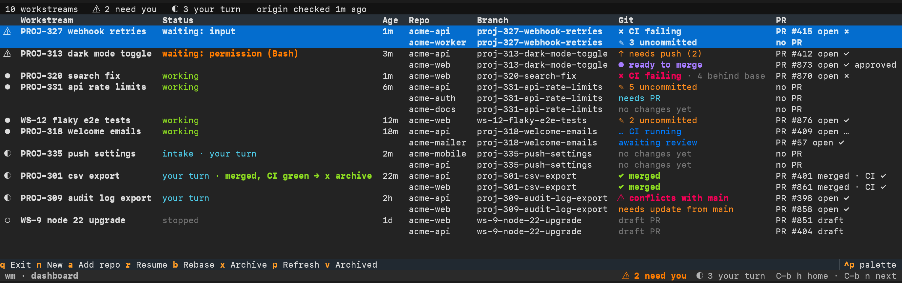

# wm in the terminal

Everything [Workstreams.app](../README.md) does, `wm` also does in the terminal: a dashboard of every workstream,
the Claude sessions it opens, and the commands behind both. Sessions live in `wm`'s own tmux server, so the app and
the terminal dashboard can be used side by side on the same workstreams.



## Install

Requires macOS, git, tmux, Claude Code, and optionally `gh` for PR and CI status.

**With the app installed**, it already carries `wm`: Settings → wm shows the command that puts it on your PATH.

**From source:**

```sh
brew install tmux
git clone https://github.com/inreachventures/agents-manager.git ~/code/agents-manager && cd ~/code/agents-manager
python3.12 -m venv .venv && .venv/bin/pip install -e .   # or: uv tool install -e .
ln -sf "$PWD/.venv/bin/wm" ~/.local/bin/wm               # Claude sessions call `wm` during intake
wm doctor                                                # checks tools, PATH and Claude folder trust
```

## Quick start

Run `wm` to open the dashboard, press `n` and describe the task in the Claude session that opens:

> "This is PROJ-313. Add a dark mode toggle: acme-api needs to store the preference and the web UI needs the
> toggle. Done when both are merged."

Claude names the workstream (`PROJ-313 dark mode toggle`), writes `TASK.md`, attaches `acme-api` and `acme-web` as
worktrees on `proj-313-dark-mode-toggle`, summarises the plan and waits for your **"go"**. Then press `C-b h` to go
back to the dashboard and get on with other work. When the PRs are merged, press `x` to archive.

## The dashboard

| Key | What it does |
|---|---|
| `n` | New workstream: a Claude session opens and you describe the task |
| `enter` | Jump into the selected workstream's Claude session |
| `a` | Attach another repo to the selected workstream |
| `r` | Resume a stopped session, in the same conversation (after a reboot, say) |
| `b` | Rebase every branch of the task that is behind its base; conflicts go to Claude |
| `x` | Archive: safety check, then stop the session and remove the worktrees |
| `v` | Show archived workstreams; `u` restores one with its worktrees and conversation |
| `p` | Refresh git, PR and CI state now |
| `q` | Leave the dashboard; sessions keep running |

Anywhere in `wm`'s tmux: `C-b h` back to the dashboard · `C-b n` next session waiting on you · `C-b d` detach.

## Commands

The dashboard and Claude both use these; `wm <command> --help` explains each.

| Command | What it does |
|---|---|
| `wm new` | Create a workstream. With no arguments you land in Claude and describe the task |
| `wm set` | Set a workstream's 3-word name and/or ticket id |
| `wm add-repo` | Attach a repo: creates the worktree and branch inside the workstream folder |
| `wm remove-repo` | Detach a repo, only if it has no uncommitted changes or commits of its own (unless `--force`) |
| `wm open` | Switch to (or attach) a workstream's session; resumes it if it stopped |
| `wm resume` | Restart a stopped session with the same conversation |
| `wm archive` | Stop the session and remove the worktrees, after a safety report |
| `wm rebase` | Rebase the branches that are behind their base; ones already on origin are force-pushed with lease |
| `wm unarchive` | Restore an archived workstream: recreate its worktrees on the same branches |
| `wm ls` | List workstreams |
| `wm repos` | List (or fuzzy-match) repos under the code roots |
| `wm branches` | List the local and remote branches of a repo |
| `wm doctor` | Check the required tools |
